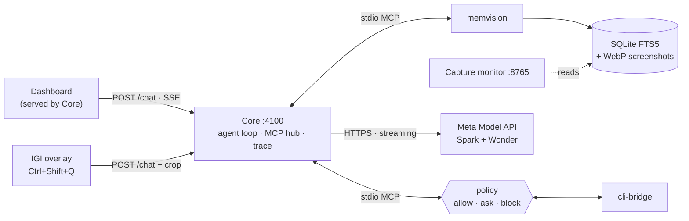

<div align="center">

# **ENHEDUANNA**

### *Knows the past, governs the present, guides the future*

</div>

---

## The Problem

In this digital world, the human mind interacts with devices constantly, and a significant portion of the data it processes arrives through the internet and screens: videos you watched, files you read, commands you ran. But the mind forgets, and details blur. A week later you can't remember which video it was, who made it, or where you saved the file. Tracking all of that by hand is a job in itself, and nobody does it.

The AI we use every day has the same blind spot. It only knows what you tell it. Either you paste in the context yourself every time, or you have to work out which context it needs and feed it manually. The knowledge is scattered across your own activity, and the tools that could use it have no way to see it.

---

## Introducing Enheduanna

Enheduanna is an on-device Desktop Intelligence that gives AI the context you already lived, so you don't have to reconstruct it by hand — made for the **Meta Global AI Developer Hackathon** in the Indie Developer Track under the *Build for Your World* project theme.

Named after Enheduanna of Ur (c. 2300 BCE), the world's first known author, it does for your desktop what she did with clay tablets: it writes down what the mind would otherwise forget, in a form you can search and act on later.

- **It remembers, with memvision.** What you watched, read and opened on screen is captured continuously and made searchable, even a week later. Ask which video you watched, who made it, or where you saved a file, and it answers in plain language.
- **It acts, with [cli-bridge](https://github.com/anshupriyan/cli-bridge/tree/meta-hackathon).** It can find and read your files and run commands in the directories you allow, governed by a policy you control over both commands and directories. Anything allowed runs immediately, anything restricted is blocked, and anything unknown asks for your approval first. Every action is written to an audit log.
- **It sees what you point at, with IGI.** IGI (Sumerian for "eye") is an on-screen overlay. Circle anything on your screen and ask about that exact thing, in context: an error, a button, a diagram. <sub>*Your rough circle is tightened to nearby UI boundaries with fast local edge detection and matched against on-device OCR, so the model sees a clean crop of what you meant — not a sloppy outline.*</sub>

**Ask about anything you saw, then act on it.**

**Private by design:** Your screen memory stays on your machine. When you ask a question, Enheduanna sends the model only what's relevant to it: your question, the matching memory snippets or files it retrieved, and screenshots only when they're needed, either of what you circled with IGI or a saved one from memory that helps answer a question about your past.

---

> [!NOTE]
> **Pre-existing work disclosure.** The only work here that predates this hackathon is **[cli-bridge](https://github.com/anshupriyan/cli-bridge)**, completely my own original open-source work (MIT licensed), my TypeScript/Node.js MCP server that gives an AI controlled shell and file access to a machine.
>
> **cli-bridge is not part of this repository.** None of its code or history is included here. It is downloaded separately as an external dependency during setup, from the [`meta-hackathon` branch](https://github.com/anshupriyan/cli-bridge/tree/meta-hackathon).
>
> - **Before I applied:** cli-bridge was published and limited to a single sandboxed workspace root, with ripgrep search and a local audit log.
> - **After I was selected, before the Oct 26 kickoff (Oct 23-24):** I added a policy mode so Enheduanna could work across the machine safely: multiple allowed directories, read-write or read-only access per directory, restricted directories, and restricted commands. Per the organizers, this counts as pre-existing work.
>
> **Every line of code in this repository was written after the kickoff.**

---

## Repository Map

| Path | What's in it |
|---|---|
| `app/` | Core TypeScript server, dual-model orchestrator loop, browser dashboard (`:4100`) |
| `memvison/` | Desktop memory daemon, WinRT OCR, FTS5 search, timeline viewer (`:8765`), MCP server |
| `igi/` | IGI screen overlay (`Ctrl+Shift+Q`). The `sam/` folder is legacy naming; snapping is local Sobel edge detection + WinRT OCR (no SAM model) |
| `scripts/` | 1-click setup, test verification (`verify_all_tests.ps1`), and background service launchers |
| `docs/` | Deep-dive architecture ([`ARCHITECTURE.md`](docs/ARCHITECTURE.md)) and date-stamped test audit logs ([`test-runs.md`](docs/test-runs.md)) |

---

## Quick Index

| Section | Description |
|---|---|
| [**Repository Map**](#repository-map) | Directory overview of `app/`, `memvison/`, `igi/`, `scripts/`, and `docs/` |
| [**Built with the Meta Model API**](#built-with-the-meta-model-api) | Dual Meta model architecture (`muse-spark-1.3` + `muse-wonder-1.0`), parallel MCP tool calls, vision limit |
| [**Architecture**](#architecture) | High-level dataflow diagram, 4-tier desktop memory pipeline, and deep-dive links to [`docs/ARCHITECTURE.md`](docs/ARCHITECTURE.md) |
| [**Setup**](#setup) | Prerequisites, 1-click `setup.bat`, configuration keys (`enheduanna.config.json`), and daemon startup |
| [**Try it**](#try-it) | Web interface (`:4100`), sample memory questions, and IGI on-screen overlay hotkey (`Ctrl+Shift+Q`) |
| [**Tools (24)**](#tools) | Complete 24-tool catalog across MemVision (9), cli-bridge (14), and Core runtime (1) |
| [**Privacy & Safety**](#privacy--safety) | 3-tier privacy engine, regex scrubbing, split-screen blackout curtain, and human approval gates |
| [**Verification**](#verification) | 1-click test runner (`verify_all_tests.ps1`), claim-to-test mapping, answer-quality eval, and [`docs/test-runs.md`](docs/test-runs.md) |
| [**Known Limits**](#known-limits) | Localhost trust, regex scrubbing boundary, screenshot retention, and Windows environment scope |
| [**License**](#license) | Root MIT license terms and subcomponent compatibility |

---

## Built with the Meta Model API

All reasoning runs through the Meta Model API (`https://api.meta.ai/v1/chat/completions`, streaming SSE). Enheduanna uses two Meta models with different jobs:

| Model | Role |
|---|---|
| `muse-spark-1.3` | **Tool agent.** Runs the loop and decides which tools to call, up to 16 steps with up to 5 tool calls in parallel per step |
| `muse-wonder-1.0` | **Synthesis.** Runs once at the end with tools disabled and writes the final answer from all the evidence gathered. If Wonder fails, Spark automatically takes over |

Spark is fast at deciding and calling tools. Wonder is better at long, detailed answers over memory, files and screenshots, so each model does the part it's best at.

- **Tool calling over MCP.** 24 tools are exposed to the model as function tools: 9 from memvision, 14 from cli-bridge, and 1 internal (`get_full_result`). Calls within a step run in parallel, and one failing call doesn't stop the others.
- **Large results.** Tool results are truncated at 64 KB (128 KB for `read_file`) and retrievable in full through `get_full_result`, so big OCR dumps and files don't fill the context window.
- **Vision.** Screenshots from memory and IGI crops are sent as images. Only the 3 most recent stay in context, and older ones are replaced with a text placeholder.
- **Reasoning.** The model's reasoning is streamed live to the dashboard's Thinking drawer.

```json
"model": {
  "provider": "meta",
  "toolModel": "muse-spark-1.3",
  "synthesisModel": "muse-wonder-1.0",
  "baseUrl": "https://api.meta.ai/v1",
  "apiKey": "YOUR_META_API_KEY_HERE"
}
```

Set your key in `META_API_KEY` (PowerShell or `.env`), in `enheduanna.config.json`, or in the dashboard's Settings. It is saved only on your machine and never sent back to the browser. See [Setup](#setup) for the exact steps.

---

## Architecture

Everything runs on your machine except the calls to the Meta Model API. **Core** is the hub: the dashboard and IGI talk to it, and it talks to memory, actions and the models.



| Arrow | What travels |
|---|---|
| Dashboard → Core | `POST /chat`, trace stream (SSE), tool list, approval responses |
| IGI → Core | `POST /chat` with the cropped image, window title, folder, page URL and on-screen text; the answer streams back to IGI |
| Core → memvision / cli-bridge | MCP over stdio: `tools/list`, `tools/call` |
| Core → Meta | Streaming chat completions (models and limits: [Built with the Meta Model API](#built-with-the-meta-model-api)) |
| Dashboard toggle → capture | Turning recording on or off starts or stops the capture loop, separate from the MCP tools |

### How a request flows

**A. Chat: "What video did I watch yesterday?"**
1. You ask in the dashboard, which sends the question to Core.
2. Spark decides what it needs and calls memvision's search tools.
3. Matching captures (OCR text, window titles, screenshots if needed) come back as tool results.
4. If it needs a file, Spark calls cli-bridge. Allowed paths run, restricted ones are blocked, and unknown ones ask you for approval.
5. Wonder gets all the evidence with tools disabled and writes the answer, streamed back to you.

**B. Circle: "What's this error?"**
1. Press the hotkey. The overlay freezes your screen and you circle the area.
2. IGI snaps your rough circle to nearby UI edges and reads the text with Windows OCR, entirely on-device.
3. IGI sends the crop, with the window title and context, to Core.
4. From here it follows the same Core loop as flow A, and the answer streams back to IGI's panel.

**C. Capture: when recording is on, independent of chat**
1. memvision takes a screenshot of your screen.
2. A privacy gate filters what's captured.
3. The text is read with Windows OCR.
4. The result is stored in a local SQLite database with full-text search, alongside compressed screenshots on disk.

### Components

| Component | Role | Details |
|---|---|---|
| **Core** (`app/core/`, `app/dashboard/`) | Server, agent loop, MCP hub, trace, approvals | [docs/ARCHITECTURE.md#core--server-agent-loop-mcp-hub-appcore--appdashboard](docs/ARCHITECTURE.md#core--server-agent-loop-mcp-hub-appcore--appdashboard) |
| **memvision** (`memvison/`) | Continuous screen memory, with 9 MCP tools | [docs/ARCHITECTURE.md#memvision-continuous-screen-memory-memvison](docs/ARCHITECTURE.md#memvision-continuous-screen-memory-memvison) |
| **IGI** (`igi/`) | Circle-to-ask overlay: local edge snapping plus WinRT OCR, no cloud segmentation | [docs/ARCHITECTURE.md#igi-circle-to-ask-eye-igi](docs/ARCHITECTURE.md#igi-circle-to-ask-eye-igi) |
| **cli-bridge** | Policy-gated file and terminal actions over MCP (14 tools), with an audit log. Pre-existing work (see the note at the top), cloned by setup as a sibling `../cli-bridge` dependency and not part of this repo | [cli-bridge](https://github.com/anshupriyan/cli-bridge/tree/meta-hackathon) |

### Ports and trust boundary

| Port | Service |
|---|---|
| `4100` | Core and dashboard |
| `8765` | memvision capture monitor (timeline viewer) |
| none | IGI talks to Core on `4100` |

Everything listens on `127.0.0.1`. Your screen memory stays on your machine, and the only traffic that leaves it is calls to the Meta Model API. Your API key is never returned to the browser.

---

## Setup

### 1. Requirements

| Need | Version |
|---|---|
| Windows | 10 or 11 (interactive desktop session) |
| Python | 3.10 or newer |
| Node.js | 18 or newer |
| Meta API key | Your own key |

*(Recommended: Having [uv](https://github.com/astral-sh/uv) installed makes Python environment setup 10x faster; `setup.bat` auto-detects it and gracefully falls back to standard pip if absent).*

### 2. Install

```cmd
.\setup.bat
```

This 1-click script handles everything automatically:
- Clones external dependency `cli-bridge` (the `meta-hackathon` branch) into `../cli-bridge` and compiles it.
- Creates `memvison/.venv` and installs the memory engine dependencies.
- **IGI Prompt:** While running, the script asks: `Install PySide6 for IGI Visual HUD now? [Y/n]`. Type **`Y`** (recommended) if you plan to test the on-screen companion HUD overlay (`Ctrl+Shift+Q`). If you skip it (`n`), setup finishes in ~10s and `scripts\launch_igi.bat` will auto-install it on first launch anyway.
- Builds `app/core` TypeScript server and dashboard.
- Generates `enheduanna.config.json` with portable relative paths.

The first install downloads about 125 MB and typically takes 1 to 3 minutes. Subsequent runs complete in ~2 seconds with instant idempotent skips.

### 3. Add your Meta API key

Open `enheduanna.config.json` in the repo root and replace the placeholder:

```json
"model": {
  "provider": "meta",
  "toolModel": "muse-spark-1.3",
  "synthesisModel": "muse-wonder-1.0",
  "baseUrl": "https://api.meta.ai/v1",
  "apiKey": "YOUR_META_API_KEY_HERE"
}
```

This file is git-ignored, so your key stays on your machine. Use a Meta key only, and don't set other provider keys while testing.

*Other ways:*
- Set `$env:META_API_KEY = "YOUR_KEY"` in the same PowerShell window you start Core from.
- Or paste the key into the dashboard's Settings modal after launch ([details](#built-with-the-meta-model-api)).

### 4. Start Core & Dashboard

```cmd
cd app\core
npm start
```

Open [http://127.0.0.1:4100](http://127.0.0.1:4100). You will see the dashboard and, in the live trace panel, both `memvision` and `cli-bridge` MCP servers connecting. You can start chatting immediately, inspect tool reasoning, and toggle screen recording.

### 5. (Optional) Launch IGI — Circle-to-Ask Visual HUD

In a separate terminal:

```cmd
.\scripts\launch_igi.bat
```

- An amber eye icon appears in your system tray and the floating obsidian HUD opens.
- Press **`Ctrl+Shift+Q`** anywhere on your desktop to freeze the screen and circle any error, button, graph, or text.
- IGI snaps to nearby UI edges, extracts native WinRT OCR context, and streams the answer from Core directly into the HUD.

> [!TIP]
> **If IGI shows "Localhost Core Offline":** Ensure your Meta API key is configured directly in `enheduanna.config.json` in the repository root (Step 3). While configuring the key through the web dashboard Settings works for browser chat, IGI reads configuration from `enheduanna.config.json` (or `$env:META_API_KEY`) to connect and authenticate with Core. Keeping your key in `enheduanna.config.json` is recommended.

### 6. Turn on memory

In the dashboard, switch recording **on**. This starts the memvision capture loop. Memory builds as you use your computer, so give it **3 to 5 minutes** before asking about your past. The steps below are ordered so you can try everything else in the meantime.

*Optional:* `cd memvison; .\.venv\Scripts\python.exe main.py ui` opens the memory timeline at http://127.0.0.1:8765.

---

## Try it

### While memory builds (works right away)

| # | Do this | What you should see |
|---|---|---|
| 1 | Press **Ctrl+Shift+Q**, circle an error message, a button or a diagram on your screen, then ask about it | IGI snaps your circle to the nearby object and answers in its window |
| 2 | In the dashboard, ask **"Find a file called [a file you know is in a folder you've allowed]."** | cli-bridge tools run without asking, because the folder is allowed. Watch the tool calls in the trace |
| 3 | Ask **"Run `echo hello` in the terminal."** | An approval card appears. Allow or deny it, and the action is written to the audit log |

### After a few minutes (needs memory)

| # | Ask | What you should see |
|---|---|---|
| 4 | **"What have I been doing for the last few minutes?"** | memvision search tools in the trace, then a summary of your recent activity, including the steps above |
| 5 | **"What did I just circle with IGI, and what was on that page?"** | The answer names what you circled, with a screenshot from memory if it needed one |
| 6 | Open a video or article for a minute, then ask **"What page or video did I just have open, and who made it?"** | The answer names it |

If an answer comes back saying there is not enough memory or no memory captured, recording was off or not enough time has passed.

---

## Tools

Enheduanna exposes 24 tools to the model: 9 from memvision, 14 from cli-bridge, and 1 internal. Spark picks which ones to call, and up to 5 run in parallel per step.

### memvision: memory (read-only)

| Tool | What it does | Gate |
|---|---|---|
| `search_desktop_memory` | Full-text search over OCR text, titles, URLs and apps, with time (`since`/`until`), app, and file filters | None |
| `get_recent_memory` | Latest captures, newest first, with active window titles, tabs, and apps | None |
| `get_capture_details` | Full OCR text, exact browser URL, metadata and window list for one capture ID | None |
| `get_memory_statistics` | Total capture counts, database size, time range, and coverage | None |
| `get_activity_sessions` | Clustered focus sessions / episodes with durations, timestamps, and frame counts | None |
| `get_capture_windows` | Z-ordered windows for a capture, with positions, visible fractions, and text snippets | None |
| `get_window_crop` | A window's screenshot crop (or full screen if `0`), privacy-blurred if needed | None |
| `get_screenshot` | A full-frame screenshot image for visual inspection and multimodal reasoning | None |
| `get_session_summaries` | Synthesized summaries of focus sessions, main apps, and activity goals | None |

### cli-bridge: actions (policy-gated)

> [!NOTE]
> `cli-bridge` is pre-existing work adapted for the hackathon. See the [cli-bridge repository (`meta-hackathon` branch)](https://github.com/anshupriyan/cli-bridge/tree/meta-hackathon) for complete standalone documentation and design.

| Tool | What it does | Gate |
|---|---|---|
| `read_file` | Read UTF-8 file contents from the workspace (supports line ranges `start_line`..`end_line`) | Allowed directories only |
| `list_directory` | List contents of a folder, optionally recursive | Allowed directories only |
| `search_files` | Find files matching a glob pattern (e.g. `*.ts`, `**/*.js`) | Allowed directories only |
| `grep_content` | Search for fixed strings in files, capped at max results | Allowed directories only |
| `write_file` | Create or overwrite a file, automatically creating parent directories | Read-write directories only |
| `edit_file` | Perform exact find-and-replace on a unique string in a file | Read-write directories only |
| `copy_file` | Copy a file from source to destination | **Asks you every time** |
| `execute_command` | Run a shell command with argument array (requires Dev Mode) | **Asks you every time**, and restricted commands are always blocked |
| `toggle_dev_mode` | Enable session-only Dev Mode required for shell commands | **Asks you every time** when enabling |
| `get_dev_mode_status` | Report whether Dev Mode is currently on | None |
| `log_journal_entry` | Append a structured summary and changed file list to `PROJECT_LOG.md` | Allowed directories only |
| `get_recent_journal_entries` | Read the last N entries from `PROJECT_LOG.md` | Allowed directories only |
| `request_path_access` | Ask to use a new folder for this session (`ro` or `rw`) | **Asks you every time**, and restricted paths can never be granted |
| `request_command_access` | Ask to allow a new command for this session | **Asks you every time**, and restricted commands can never be granted |

### Internal

| Tool | What it does | Gate |
|---|---|---|
| `get_full_result` | Fetch the full text of a tool result that was truncated into an LRU buffer (64 KB, or 128 KB for `read_file`) | None |

**How the gates work.** "Allowed directories only" means the call runs immediately inside a directory you've allowed and is blocked everywhere else. "Asks you every time" means Core pauses and shows an Allow/Deny card (auto-deny after 120 s). Even after you approve, cli-bridge re-checks its restricted lists and can still block the call. Every action is written to `.cli-bridge-audit.log`. See [Privacy & Safety](#privacy--safety).

---

## Privacy & Safety

Your screen memory stays on your machine. When you ask a question, Enheduanna reads local memory and sends the model only the pieces that question needs.

### What stays on your machine, and what leaves

Screenshots, OCR text and the SQLite database live in `memvison/data/` on local disk. OCR runs entirely on-device through Windows WinRT, so no image or text is sent anywhere for recognition (`memvison/src/memvision/ocr.py`).

Many questions are answered from OCR text alone. Some need to look at a screenshot, and then Enheduanna opens the relevant one from local memory. Either way, nothing is uploaded in bulk. The memory stays in place, and only the specific snippets, files or screenshots needed for your question are included in the request.

The only traffic that leaves your machine is HTTPS calls to the Meta Model API: Core's Spark and Wonder turns, IGI's direct fallback when Core is down, and the memvision monitor's standalone chat, which is restricted to `META_API_KEY` (`memvison/src/memvision/ai_chat.py`). Your API key is never returned to the browser: `/health` and `/api/config` expose only `hasApiKey: true/false` (`app/core/src/server.ts`).

### Actions: two gates before anything runs

| What Enheduanna tries to do | What happens |
|---|---|
| Read, list, search, write or edit inside a directory you've allowed read-write | Runs immediately |
| Run a shell command, copy a file, request new path or command access | Pauses for your Allow/Deny click (120 s, auto-deny on timeout) |
| Anything restricted | Blocked, even if you approve |

Approval never overrides policy. After you click Allow, cli-bridge checks again and still blocks restricted commands (`curl`, `format`, `shutdown`, ...), inline interpreters (`powershell -Command`, `cmd /c`, `python -c`, ...), restricted paths (`~/.ssh`, credential stores, browser profiles, which can't be granted even by you), and anything outside your allowed roots. The restricted lists ship with sensible defaults, and you can add to them in your policy file. Every action is written to `.cli-bridge-audit.log`. For the full tables, see the approvals part of the Core section in [docs/ARCHITECTURE.md#8-approvals--two-layers-srcagentapprovalts--cli-bridge-policy](docs/ARCHITECTURE.md#8-approvals--two-layers-srcagentapprovalts--cli-bridge-policy).

### Local servers: Host and Origin validation

Binding to `127.0.0.1` isn't enough on its own, because a website open in your browser can normally fetch `localhost`. So both servers validate every request (`app/core/src/server.ts`, `memvison/src/memvision/web_server.py`): the `Host` header must be a loopback name, so DNS-rebinding names get a 403, and any browser `Origin` header must match the server's own origin or the request is rejected. IGI, curl and other local tools send no `Origin` and are unaffected. The trust model is the local user: any process already running as you can call the APIs, since there is no per-request auth token.

<details>
<summary><b>Capture masking: app, window and URL level</b></summary>

Before anything is stored, every visible window is checked against `memvison/config/privacy_rules.json` (`memvison/src/memvision/privacy.py`). It ships preconfigured with common sensitive targets, and you can add or remove anything in that file:

| Level | What's matched | Preconfigured examples |
|---|---|---|
| **App** | Process name, case-insensitive glob + regex | Password managers (`1password.exe`, `bitwarden.exe`, `keepassxc.exe`, `lastpass.exe`, `dashlane.exe`), Windows auth UI (`credentialui.exe`, `consent.exe`), authenticators (`authy.exe`), `discord*.exe` |
| **Window title** | Title glob | `*Incognito*`, `*InPrivate*`, `*Master Password*`, `*Enter PIN*`, `*.env*`, `*id_rsa*`, `*credentials*` |
| **URL** | Active tab URL via UI Automation | Banks (`*chase.com*`, `*paypal.com*`, `*coinbase.com*`), identity (`*accounts.google.com/signin*`, `*okta.com*`), browser internals (`chrome://password-manager*`, `brave://wallet*`, `about:logins*`) |

These are starting points, not a fixed list. Edit the rules for your own setup, for example to mask a work chat app or to unblock one of the defaults.

The default mode is `blocklist` with `action_on_block: drop`: a match stores nothing, with no database row and no image. Set it to `redact` and a `[REDACTED]` marker is stored instead. You can also switch to `allowlist` mode with `allowed_apps` / `allowed_urls`. Rules hot-reload when the file changes, with no restart needed. To test the gate without capturing anything:

```powershell
python main.py privacy-test --app 1password.exe --title "Master Password"
```

</details>

<details>
<summary><b>Spatial masking: the split-screen problem</b></summary>

You're coding on the left and Discord is open on the right. A naive recorder photographs both. Enheduanna evaluates every visible window, not just the foreground one (`filter_blocked_windows()`), and paints an opaque curtain over violating rectangles before OCR runs (`memvison/src/memvision/capture.py`), so their text is never read. If the active window is blocked but covers under 85% of the screen while an allowed window is visible, the capture is rescued onto the allowed window instead of dropped. Pixels hidden underneath another window are blanked to neutral gray inside each crop, so covered text can't leak, and `redact` windows are blurred with their text replaced. Which apps were masked is recorded in capture metadata (`is_spatially_masked`) so you can audit it later.

</details>

<details>
<summary><b>Secret scrubbing: before storage, not after</b></summary>

A set of built-in regex families in `privacy.py` runs over every OCR result and window title before the SQLite insert. They cover common credential formats: API keys (`sk-*`, `sk-ant-*`, `sk-or-v1-*`, Google `AIza`, AWS `AKIA*`, Hugging Face `hf_*`), GitHub tokens (`ghp_*`), Slack tokens (`xox*-`), Bearer tokens, `api_key` / `secret` / `password` assignments, JWTs, private-key blocks, URL query secrets and document-hash fragments. You can add your own patterns in `privacy_rules.json`, and they merge with the built-in ones.

URLs get a dedicated pass: public parameters are kept (`q`, `v`, `scope`), sensitive ones are replaced (`state`, `code`, `token`, `session_id`, `sig`), along with long hex values, fragments and `/viewer/` path hashes.

Three more layers sit on top. `python main.py sanitize` retroactively re-runs the gate over old rows. `get_window_crop` and `get_screenshot` re-evaluate privacy when serving and blur violating crops. Core's trace bus scrubs known credential patterns before anything reaches the dashboard (`app/core/src/trace/bus.ts`).

</details>

*(For the complete security and architectural boundary analysis, see [Known Limits](#known-limits)).*

---

## Verification

### 1. Run everything (1 command)

```powershell
powershell -ExecutionPolicy Bypass -File .\scripts\verify_all_tests.ps1
```

That script executes two suites in sequence:
- `pytest -v` in `memvison/`
- `npm test` in `app/core/`

To run suites individually:

```powershell
# MemVision memory, privacy, and OCR tests
cd memvison; .\.venv\Scripts\python.exe -m pytest -v

# Core server, loop, and approval tests
cd app\core; npm test

# IGI desktop companion overlay tests
cd igi; ..\memvison\.venv\Scripts\python.exe test_igi.py
```

*(Note: cli-bridge has its own standalone test suite in its [repository](https://github.com/anshupriyan/cli-bridge/tree/meta-hackathon)).*

### 2. What the suites cover — mapping tests to claims

| Claim in README | Proven by |
|---|---|
| App/title/URL masking + secret scrub | `memvison/tests/test_privacy.py` |
| Split-screen blackout curtain | `memvison/tests/test_spatial_privacy.py` |
| Video suppression (0.90 similarity) | `memvison/tests/test_stability.py` |
| FTS5 search + episodes | `test_storage.py`, `test_episodes.py`, `test_mcp.py` |
| 16 steps / 5 parallel / loop guards | `app/core/test/orchestrator_loop.test.js` |
| 5 approval gates, 120s timeout | `app/core/test/approval.test.js` |
| 3-image limit, screenshot handling | `app/core/test/vision.test.js` |
| "Never claim user didn't do X" | `app/core/test/coverage_limit.test.js` |

**Suite inventory:**
- **memvision (11 files in `memvison/tests/`):** privacy, spatial privacy, stability, storage, episodes, MCP protocol, change detector, window capture, web server, path resolution, and AI chat fallback.
- **Core (6 files in `app/core/test/`):** approval gates, orchestrator loop, session persistence, vision message handling, integration acceptance, and coverage limit handling.
- **IGI (`igi/test_igi.py`):** 19 tests covering geometric bounding, Sobel edge snapping, WinRT OCR context extraction, HUD resizing, lightbox previews, and multi-block walkthroughs. *(Note: References to "SAM" in test names and folder paths are legacy compatibility aliases from an early prototype; as documented in [Architecture](docs/ARCHITECTURE.md#igi-circle-to-ask-eye-igi), no SAM neural network or model runs — snapping is 100% deterministic local Sobel edge detection plus native WinRT OCR).*

### 3. Answer-quality eval (`app/core/eval/quality_eval.js`)

Beyond unit tests, `app/core/eval/quality_eval.js` implements an answer-quality rubric to verify that synthesized responses are human-usable rather than raw diagnostic dumps:
- Evaluates 10 representative scenarios (multitasking, work sessions, distraction, debugging, code inspection, research, media history, productivity, app detection, session summaries) against expected gists and deterministic mock evidence.
- Scored 0–100 by `judgeAnswer()`:

| Check | Points |
|---|---|
| No raw capture IDs | 20 (hard gate) |
| No OCR dumps, ≤800 chars | 20 (hard gate) |
| No raw window IDs or hex handles | 15 |
| Concise lead, ≤6 sentences | 15 |
| Purpose-grouped (coding / watching / debugging) | 15 |
| Duration-aware (minutes / glance / background) | 15 |

Pass requires **≥70 points** and **both hard gates**.

*Status:* The harness defines the quality rubric and reference answers for both Spark-only and Spark+Wonder modes. Live-model scoring against this rubric is future work.

### 4. Verified results

Last verified: **2026-11-02**, commit `f7dc59b`, Windows 11, Python 3.12, Node 20:
- **memvision:** 35 passed, 0 failed
- **Core:** 20 passed, 0 failed
- **IGI:** 19 passed, 0 failed

For full transcripts and detailed test logs, see [docs/test-runs.md](docs/test-runs.md).

---

## Known Limits

1. **Localhost trust.** No per-request auth on `:4100` / `:8765` — any local process can call the APIs. Browser cross-origin requests are rejected (Host + Origin validation).
2. **Regex-based scrubbing.** Known credential patterns are scrubbed before storage; unusual formats can slip through.
3. **Screenshot retention.** Images prune at 500MB / 7 days, but database rows are not auto-pruned — old memories keep text, lose images.
4. **Windows-only.** Requires Windows 10/11 and Python 3.10+ in an interactive session.
5. **Drafts not collapsed.** Typing growth is detected, but the capture loop doesn't use the in-place update — drafts store as separate captures.
6. **IGI is text-first.** Icons/diagrams are answered from the crop by model vision, not located locally. The `sam/` name is legacy (Sobel + OCR, no SAM model); on-screen halos are disabled, HUD only.

---

## License

This project is licensed under the [MIT License](LICENSE).
