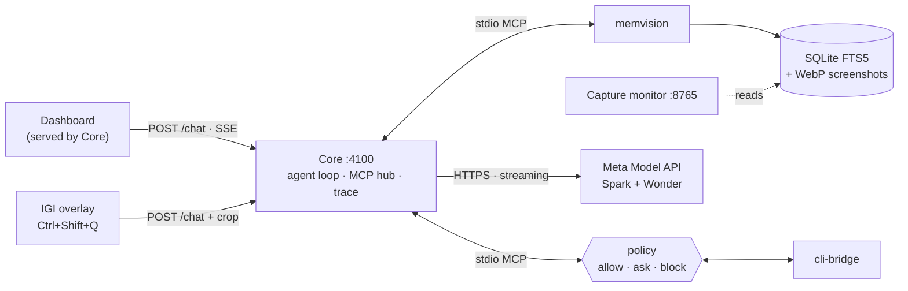

<div align="center">

# **ENHEDUANNA**

### *Knows the past, governs the present, guides the future*

</div>

---

## The Problem

In this digital world, the human mind interacts with devices constantly, and a significant portion of the data it processes arrives through the internet and screens: videos you watched, files you read, commands you ran. But the mind forgets, and details blur. A week later you can't remember which video it was, who made it, or where you saved the file. Tracking all of that by hand is a job in itself, and nobody does it.

The AI we use every day has the same blind spot. It only knows what you tell it. Either you paste in the context yourself every time, or you have to work out which context it needs and feed it manually. The knowledge is scattered across your own activity, and the tools that could use it have no way to see it.

---

## Introducing Enheduanna

Enheduanna is an on-device Desktop Intelligence that gives AI the context you already lived, so you don't have to reconstruct it by hand.

Named after Enheduanna of Ur (c. 2300 BCE), the world's first known author, it does for your desktop what she did with clay tablets: it writes down what the mind would otherwise forget, in a form you can search and act on later.

- **It remembers, with memvision.** What you watched, read and opened on screen is captured continuously and made searchable, even a week later. Ask which video you watched, who made it, or where you saved a file, and it answers in plain language.
- **It acts, with [cli-bridge](https://github.com/anshupriyan/cli-bridge/tree/meta-hackathon).** It can find and read your files and run commands in the directories you allow, governed by a policy you control over both commands and directories. Anything allowed runs immediately, anything restricted is blocked, and anything unknown asks for your approval first. Every action is written to an audit log.
- **It sees what you point at, with IGI.** IGI (Sumerian for "eye") is an on-screen overlay. Circle anything on your screen and ask about that exact thing, in context: an error, a button, a diagram. <sub>*Your rough circle is tightened to nearby UI boundaries with fast local edge detection and matched against on-device OCR, so the model sees a clean crop of what you meant — not a sloppy outline.*</sub>

**Ask about anything you saw, then act on it.**

**Private by design:** Your screen memory stays on your machine. When you ask a question, Enheduanna sends the model only what's relevant to it: your question, the matching memory snippets or files it retrieved, and screenshots only when they're needed, either of what you circled with IGI or a saved one from memory that helps answer a question about your past.

---

> [!NOTE]
> **Pre-existing work disclosure.** The only work here that predates this hackathon is **[cli-bridge](https://github.com/anshupriyan/cli-bridge)**, my TypeScript/Node.js MCP server that gives an AI controlled shell and file access to a machine.
>
> **cli-bridge is not part of this repository.** None of its code or history is included here. It is downloaded separately as an external dependency during setup, from the [`meta-hackathon` branch](https://github.com/anshupriyan/cli-bridge/tree/meta-hackathon).
>
> - **Before I applied:** cli-bridge was published and limited to a single sandboxed workspace root, with ripgrep search and a local audit log.
> - **After I was selected, before the Oct 26 kickoff (Oct 23-24):** I added a policy mode so Enheduanna could work across the machine safely: multiple allowed directories, read-write or read-only access per directory, restricted directories, and restricted commands. Per the organizers, this counts as pre-existing work.
>
> **Every line of code in this repository was written after the kickoff.**

---

## Built with the Meta Model API

All reasoning runs through the Meta Model API (`https://api.meta.ai/v1/chat/completions`, streaming SSE). Enheduanna uses two Meta models with different jobs:

| Model | Role |
|---|---|
| `muse-spark-1.3` | **Tool agent.** Runs the loop and decides which tools to call, up to 16 steps with up to 5 tool calls in parallel per step |
| `muse-wonder-1.0` | **Synthesis.** Runs once at the end with tools disabled and writes the final answer from all the evidence gathered. If Wonder fails, Spark automatically takes over |

Spark is fast at deciding and calling tools. Wonder is better at long, detailed answers over memory, files and screenshots, so each model does the part it's best at.

- **Tool calling over MCP.** 24 tools are exposed to the model as function tools: 9 from memvision, 14 from cli-bridge, and 1 internal (`get_full_result`). Calls within a step run in parallel, and one failing call doesn't stop the others.
- **Large results.** Tool results are truncated at 64 KB (128 KB for `read_file`) and retrievable in full through `get_full_result`, so big OCR dumps and files don't fill the context window.
- **Vision.** Screenshots from memory and IGI crops are sent as images. Only the 3 most recent stay in context, and older ones are replaced with a text placeholder.
- **Reasoning.** The model's reasoning is streamed live to the dashboard's Thinking drawer.

```json
"model": {
  "provider": "meta",
  "toolModel": "muse-spark-1.3",
  "synthesisModel": "muse-wonder-1.0",
  "baseUrl": "https://api.meta.ai/v1",
  "apiKey": "YOUR_META_API_KEY_HERE"
}
```

Set your key in `META_API_KEY` (PowerShell or `.env`), in `enheduanna.config.json`, or in the dashboard's Settings. It is saved only on your machine and never sent back to the browser. See [Setup](#setup) for the exact steps.

---

## Architecture

Everything runs on your machine except the calls to the Meta Model API. **Core** is the hub: the dashboard and IGI talk to it, and it talks to memory, actions and the models.



| Arrow | What travels |
|---|---|
| Dashboard → Core | `POST /chat`, trace stream (SSE), tool list, approval responses |
| IGI → Core | `POST /chat` with the cropped image, window title, folder, page URL and on-screen text; the answer streams back to IGI |
| Core → memvision / cli-bridge | MCP over stdio: `tools/list`, `tools/call` |
| Core → Meta | Streaming chat completions (models and limits: [Built with the Meta Model API](#built-with-the-meta-model-api)) |
| Dashboard toggle → capture | Turning recording on or off starts or stops the capture loop, separate from the MCP tools |

### How a request flows

**A. Chat: "What video did I watch yesterday?"**
1. You ask in the dashboard, which sends the question to Core.
2. Spark decides what it needs and calls memvision's search tools.
3. Matching captures (OCR text, window titles, screenshots if needed) come back as tool results.
4. If it needs a file, Spark calls cli-bridge. Allowed paths run, restricted ones are blocked, and unknown ones ask you for approval.
5. Wonder gets all the evidence with tools disabled and writes the answer, streamed back to you.

**B. Circle: "What's this error?"**
1. Press the hotkey. The overlay freezes your screen and you circle the area.
2. IGI snaps your rough circle to nearby UI edges and reads the text with Windows OCR, entirely on-device.
3. IGI sends the crop, with the window title and context, to Core.
4. From here it follows the same Core loop as flow A, and the answer streams back to IGI's panel.

**C. Capture: when recording is on, independent of chat**
1. memvision takes a screenshot of your screen.
2. A privacy gate filters what's captured.
3. The text is read with Windows OCR.
4. The result is stored in a local SQLite database with full-text search, alongside compressed screenshots on disk.

### Components

| Component | Role | Details |
|---|---|---|
| **Core** (`app/core/`, `app/dashboard/`) | Server, agent loop, MCP hub, trace, approvals | [docs/ARCHITECTURE.md#core--server-agent-loop-mcp-hub-appcore--appdashboard](docs/ARCHITECTURE.md#core--server-agent-loop-mcp-hub-appcore--appdashboard) |
| **memvision** (`memvison/`) | Continuous screen memory, with 9 MCP tools | [docs/ARCHITECTURE.md#memvision-continuous-screen-memory-memvison](docs/ARCHITECTURE.md#memvision-continuous-screen-memory-memvison) |
| **IGI** (`igi/`) | Circle-to-ask overlay: local edge snapping plus WinRT OCR, no cloud segmentation | [docs/ARCHITECTURE.md#igi-circle-to-ask-eye-igi](docs/ARCHITECTURE.md#igi-circle-to-ask-eye-igi) |
| **cli-bridge** | Policy-gated file and terminal actions over MCP (14 tools), with an audit log. Pre-existing work (see the note at the top), cloned by setup as a sibling `../cli-bridge` dependency and not part of this repo | [cli-bridge](https://github.com/anshupriyan/cli-bridge/tree/meta-hackathon) |

### Ports and trust boundary

| Port | Service |
|---|---|
| `4100` | Core and dashboard |
| `8765` | memvision capture monitor (timeline viewer) |
| none | IGI talks to Core on `4100` |

Everything listens on `127.0.0.1`. Your screen memory stays on your machine, and the only traffic that leaves it is calls to the Meta Model API. Your API key is never returned to the browser.

### Repo map

| Path | What's in it |
|---|---|
| `app/` | Core server, agent loop, dashboard |
| `memvison/` | memvision: screen memory, OCR, search, MCP server |
| `igi/` | IGI overlay. The `sam/` folder and file names are legacy from an early SAM-based design; the current snapping is local edge detection plus WinRT OCR, with no SAM model involved |
| `scripts/` | Setup and run scripts |
| `docs/` | Deeper notes |

---

## Setup

### 1. Requirements

| Need | Version |
|---|---|
| Windows | 10 or 11 (interactive desktop session) |
| Python | 3.10 or newer |
| Node.js | 18 or newer |
| Meta API key | Your own key |

*(Recommended: Having [uv](https://github.com/astral-sh/uv) installed makes Python environment setup 10x faster; `setup.bat` auto-detects it and gracefully falls back to standard pip if absent).*

### 2. Install

```cmd
.\setup.bat
```

This 1-click script handles everything automatically:
- Clones external dependency `cli-bridge` (the `meta-hackathon` branch) into `../cli-bridge` and compiles it.
- Creates `memvison/.venv` and installs the memory engine dependencies.
- **IGI Prompt:** While running, the script asks: `Install PySide6 for IGI Visual HUD now? [Y/n]`. Type **`Y`** (recommended) if you plan to test the on-screen companion HUD overlay (`Ctrl+Shift+Q`). If you skip it (`n`), setup finishes in ~10s and `scripts\launch_igi.bat` will auto-install it on first launch anyway.
- Builds `app/core` TypeScript server and dashboard.
- Generates `enheduanna.config.json` with portable relative paths.

The first install downloads about 125 MB and typically takes 1 to 3 minutes. Subsequent runs complete in ~2 seconds with instant idempotent skips.

### 3. Add your Meta API key

Open `enheduanna.config.json` in the repo root and replace the placeholder:

```json
"model": {
  "provider": "meta",
  "toolModel": "muse-spark-1.3",
  "synthesisModel": "muse-wonder-1.0",
  "baseUrl": "https://api.meta.ai/v1",
  "apiKey": "YOUR_META_API_KEY_HERE"
}
```

This file is git-ignored, so your key stays on your machine. Use a Meta key only, and don't set other provider keys while testing.

*Other ways:*
- Set `$env:META_API_KEY = "YOUR_KEY"` in the same PowerShell window you start Core from.
- Or paste the key into the dashboard's Settings modal after launch ([details](#built-with-the-meta-model-api)).

### 4. Start Core & Dashboard

```cmd
cd app\core
npm start
```

Open [http://127.0.0.1:4100](http://127.0.0.1:4100). You will see the dashboard and, in the live trace panel, both `memvision` and `cli-bridge` MCP servers connecting. You can start chatting immediately, inspect tool reasoning, and toggle screen recording.

### 5. (Optional) Launch IGI — Circle-to-Ask Visual HUD

In a separate terminal:

```cmd
.\scripts\launch_igi.bat
```

- An amber eye icon appears in your system tray and the floating obsidian HUD opens.
- Press **`Ctrl+Shift+Q`** anywhere on your desktop to freeze the screen and circle any error, button, graph, or text.
- IGI snaps to nearby UI edges, extracts native WinRT OCR context, and streams the answer from Core directly into the HUD.

### 6. Turn on memory

In the dashboard, switch recording **on**. This starts the memvision capture loop. Memory builds as you use your computer, so give it **3 to 5 minutes** before asking about your past. The steps below are ordered so you can try everything else in the meantime.

*Optional:* `cd memvison; .\.venv\Scripts\python.exe main.py ui` opens the memory timeline at http://127.0.0.1:8765.

---

## Try it

### While memory builds (works right away)

| # | Do this | What you should see |
|---|---|---|
| 1 | Press **Ctrl+Shift+Q**, circle an error message, a button or a diagram on your screen, then ask about it | IGI snaps your circle to the nearby object and answers in its window |
| 2 | In the dashboard, ask **"Find a file called [a file you know is in a folder you've allowed]."** | cli-bridge tools run without asking, because the folder is allowed. Watch the tool calls in the trace |
| 3 | Ask **"Run `echo hello` in the terminal."** | An approval card appears. Allow or deny it, and the action is written to the audit log |

### After a few minutes (needs memory)

| # | Ask | What you should see |
|---|---|---|
| 4 | **"What have I been doing for the last few minutes?"** | memvision search tools in the trace, then a summary of your recent activity, including the steps above |
| 5 | **"What did I just circle with IGI, and what was on that page?"** | The answer names what you circled, with a screenshot from memory if it needed one |
| 6 | Open a video or article for a minute, then ask **"What page or video did I just have open, and who made it?"** | The answer names it |

If an answer comes back saying there is not enough memory or no memory captured, recording was off or not enough time has passed.
