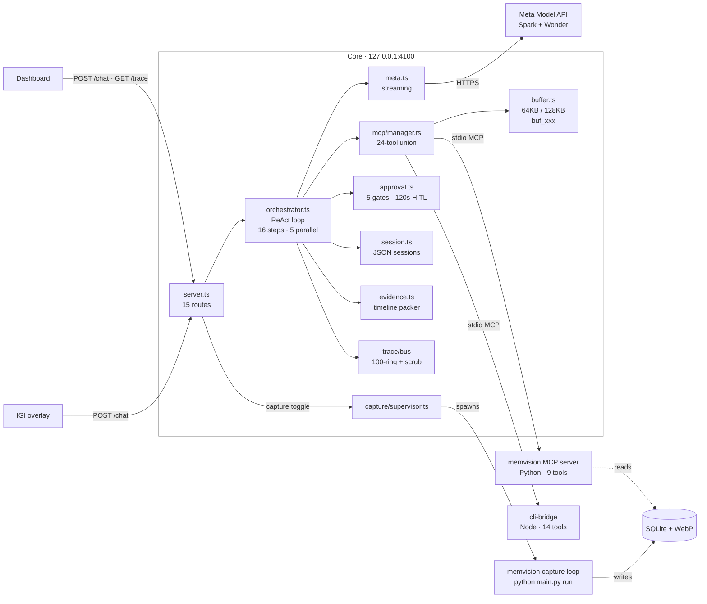
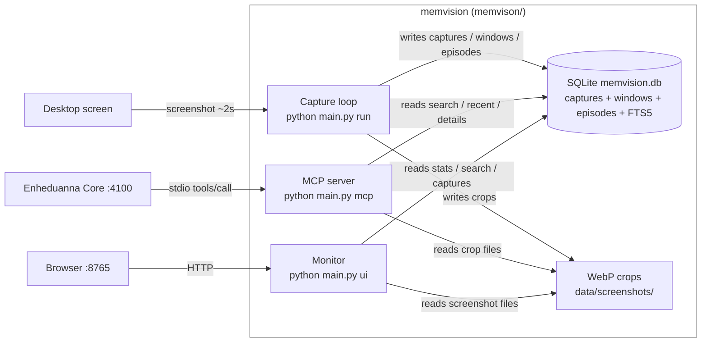
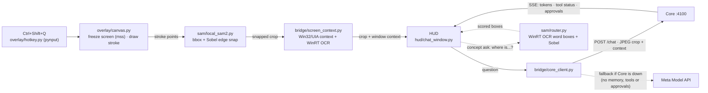

# Core — Server, Agent Loop, MCP Hub (`app/core/` + `app/dashboard/`)

> **TL;DR:** One Node process on `127.0.0.1:4100` that serves the dashboard,
> runs a 16-step / 5-parallel ReAct loop (Spark tools → Wonder synthesis),
> unions 24 MCP tools from two subprocesses, streams a secret-scrubbed trace,
> and gates 5 dangerous tools behind 120s human approval.
> Verified against the submission source; see §14 for known limits.

> Stack: Node 18+, TypeScript 5.7 strict, `node:http` (no Express), MCP SDK 1.0.
> Entry: `npm start` → `node dist/index.js` → `src/index.ts`.

## 1. What it does

Core is the hub everything talks through. It serves the dashboard UI, runs the
ReAct agent loop against the Meta Model API, multiplexes two MCP subprocesses
into one tool surface, streams every step to an observable trace, and gates
dangerous tools behind human approval. One process, port `127.0.0.1:4100`.

## 2. The ReAct loop (`src/agent/orchestrator.ts`)

`runTurn()` loops up to `maxSteps` (default 16). Each `executeStep()`:

1. Picks the model: Spark (`toolModel`) for tool steps, Wonder
   (`synthesisModel`) for the final pass with `tools = []`.
2. Streams one model turn via `provider.callStreaming()` — reasoning tokens go
   to the Thinking drawer, tool calls are reassembled from SSE deltas.
3. Slices the first `maxParallelToolCalls` (default 5); extras get
   `[Skipped: Exceeded maximum parallel tool call limit...]`.
4. Executes the slice with `Promise.allSettled` — one failure becomes
   `[Tool Error: ...]`, the rest continue.
5. Appends every result as a contiguous `role: tool` block, then at most ONE
   multimodal `role: user` image message if a tool returned a screenshot.
   (Strict ordering avoids the tool-sequence HTTP 400.)
6. Repeats until Spark answers directly, or a guard fires.

Synthesis: when two-model routing is on and tools ran (or no terminal answer
exists), Wonder receives `[ACTION RESULTS]` (non-memory, 400 chars each) +
`[VERIFIED TIMELINE EVIDENCE]` (packed JSON, see §7) with tools disabled, and
streams the final answer. Hallucinated tool calls in this phase are discarded.

## 3. Guards that keep it safe

| Guard | Limit | Behavior | Signal |
|---|---|---|---|
| Step cap | 16 steps | Break to synthesis | `step_cap_reached` |
| Parallel cap | 5 calls/step | Extras skipped with notice | in tool results |
| Repeat cap | 2 identical calls/turn | Reuse cached result, break | `isRepeatCapHit` |
| Operator cap | 3 consecutive `execute_command` | Break to synthesis | `operator_limit_reached` |
| Synthesis strip | — | Wonder's tool calls discarded | silent |
| Model fallback | — | Wonder error → retry with Spark | `synthesis_fallback` |

Repeat detection keys on `name + JSON.stringify(args)` per turn. The operator
cap counts consecutive shell calls and resets on any non-shell step.

## 4. MCP hub (`src/mcp/manager.ts`, `src/mcp/buffer.ts`)

Two stdio subprocesses are spawned at boot and unioned into one tool list:

- **memvision:** `memvison/.venv/Scripts/python.exe main.py mcp` → 9 tools
- **cli-bridge:** `node build/index.js --policy policy.json` (cwd
  `../cli-bridge`) → 14 tools
- **internal:** `get_full_result(result_id)` → 1 tool, handled in-process

Total: **24 tools**, translated to Chat Completions
`tools: [{type: "function", function: {name, description, parameters}}]`.

`ToolResultBuffer` truncates anything over 64,000 chars (128,000 for
`read_file`) into an LRU-50 store keyed `buf_<8hex>`, with a preview +
`call get_full_result(...)` pointer. Image blocks from memvision crops are
extracted, passed to the model as `image_url`, and surfaced to the dashboard
as zero-token gallery thumbnails.

## 5. Meta provider (`src/providers/meta.ts`)

`POST {baseUrl}/chat/completions`, `stream: true`, `temperature: 0.2`,
`reasoning_effort` passthrough, `Authorization: Bearer <key>`.
`sanitizeMessagesForMetaApi()` enforces two Meta constraints before every call:

- Only the first message may keep `role: system`; later ones demote to `user`.
- Only the 3 most recent `image_url` parts are kept; older images become the
  text `[Historical Screenshot Analyzed]`.

Reasoning deltas (`reasoning_content` / `reasoning` / `thought`) stream to the
Thinking drawer; usage tokens are captured from the SSE tail.

## 6. Trace bus (`src/trace/bus.ts`)

Every model call, tool call/group, approval, capture event, and error emits a
`TraceEvent` (`tr_<ts>_<rand>`) into a 100-event ring buffer, SSE-streamed via
`GET /trace` (30-event replay on connect, 15s keepalive). All payloads pass
through 7 secret-scrub regexes (`sk-`, `sk-ant-`, `ghp_`, `Bearer`, `AIza`,
key/secret/token assignments) before storage — known credential patterns are
scrubbed from traces and the dashboard.

## 7. Evidence packer (`src/agent/evidence.ts`)

Memory tool results are unusable raw (dozens of overlapping captures), so
`EvidencePacker.packEvidence()` compresses them into a timeline for Wonder:

1. Parse `results[]` / `captures[]` + nested `windows[]`, sort chronologically.
2. Merge same app+title within a 30s gap into segments (max visible fraction,
   OR'd foreground, dedup'd OCR capped at 200 chars).
3. Tag each segment's purpose: `project_tools` / `video` / `coding` /
   `communication` / `research` / `system` / `browsing` (app + title + domain
   heuristics).
4. If > 8 segments, drop sub-3s ones unless the query names that app/title.
5. Emit `{summary: {start, end, total_duration_s, segment_count,
   primary_purposes}, segments[]}` as `[VERIFIED TIMELINE EVIDENCE]`.

## 8. Approvals — two layers (`src/agent/approval.ts` + cli-bridge policy)

Safety is two independent gates that stack. Core asks you; cli-bridge decides
whether the call is allowed at all. Approval in Core never overrides a
cli-bridge restriction.

**Layer 1 — Core HITL (interactive, always-ask).** Five tools pause the loop
on *every* call, with no allow-list bypass at this layer:

| Tool | Prompt |
|---|---|
| `copy_file` | File Copy Authorization (source → dest) |
| `request_path_access` | Filesystem Path Access (path + ro/rw) |
| `execute_command` | Shell Command Execution (command + args) |
| `toggle_dev_mode` (enable) | Developer Mode Activation |
| `request_command_access` | Command Policy Approval |

Each creates an `appr_xxx` request with a 120s auto-deny timer, streamed as
`approval_required` and resolved via `POST /api/approvals/:id`. Denial (or
timeout) returns `[Permission Denied by User...]` and the tool never reaches
cli-bridge. An approved `execute_command` auto-enables Dev Mode on cli-bridge
so the call can proceed. (Identical repeats within one turn are served from
the loop-guard cache before this check, so they don't prompt twice.)

**Layer 2 — cli-bridge policy (non-interactive, fail-closed).** After Layer 1
passes, `checkCommand()` / `checkPath()` re-check inside cli-bridge:
built-in + config restricted commands, inline interpreters
(`powershell -Command`, `cmd /c`), shell metachars, and restricted/outside-root
paths are denied even if you just approved. Its `ask` tier uses a
default-deny approver (no UI on that side), so unknown items only pass via
pre-granted session roots/commands — and restricted entries can never be
granted. Ungated reads/writes inside an allowed `rw` root
(`read_file`, `list_directory`, `grep_content`, `write_file`, `edit_file`)
run without a Layer 1 prompt.

## 9. Sessions (`src/agent/session.ts`)

`sess_<12hex>` IDs persisted to `data/sessions.json` (auto-created). Titles
auto-derive from the first user message (40 chars). The system prompt
(`prompts/system_prompt.txt`, ~11KB, 13 rules + few-shots) is re-rendered with
live UTC + Asia/Kolkata timestamps at the top of every turn via
`prompts/loader.ts`.

## 10. HTTP surface (`src/server.ts`)

Plain `node:http`, 15 method+path routes, 2MB JSON body cap, CORS `*`,
traversal-guarded static serving of `app/dashboard/` with SPA fallback. Auth
is open localhost dev mode (`auth.ts` returns true) — see §14.

| Method + Path | Purpose |
|---|---|
| `GET /health` | Status + model config (`hasApiKey` boolean only) + MCP + capture |
| `GET /tools` | Unioned 24-tool list |
| `GET /trace` | SSE trace stream |
| `POST /chat` | SSE agentic turn (`sessionId?`, `message`, `images?`, `options?`) |
| `GET /api/capture/status` | Capture loop state |
| `POST /api/capture/toggle` | Start/stop capture loop |
| `GET /api/capture/image/:id` | Screenshot data-URL for lightbox (zero model tokens) |
| `GET /api/sessions` | List sessions (no message bodies) |
| `POST /api/sessions` | Create session |
| `GET /api/sessions/:id` | Full session incl. messages |
| `DELETE /api/sessions/:id` | Delete session |
| `GET /api/config` | Settings (`hasApiKey` boolean only, never the key) |
| `POST /api/config` | Save settings (key persisted to `.env` + config) |
| `GET /api/approvals` | List pending HITL requests |
| `POST /api/approvals/:id` | Resolve HITL request (allow/deny) |

## 11. Capture supervisor (`src/capture/supervisor.ts`)

Spawns `python main.py run --interval 2.0` in the memvision dir with resolved
DB/screenshot paths (`windowsHide: true`), pipes informative stdout
(`Captured`/`Dropped`/`Sanitized`) into the trace bus, and kills via
SIGTERM → 1.5s → SIGKILL. Started/stopped only through the dashboard toggle —
never auto-started on boot.

## 12. Dashboard (`app/dashboard/`, zero-build)

Vanilla JS/CSS, no framework, no build step (`index.html` 12KB, `app.js`
66KB, `styles.css` 41KB). SSE chat + trace streams, Thinking drawer with live
timer, collapsible tool cards (name, duration, preview, buffer ID, errors),
screenshot galleries with lightbox, approval Allow/Deny cards, multi-session
sidebar, and a settings modal (provider, model, reasoning, key) persisted via
`POST /api/config`. Rendered markdown is sanitized with DOMPurify.

## 13. File map

| File | Role |
|---|---|
| `src/index.ts` | Boot: config → buffer limit → key check → MCP init → listen |
| `src/config.ts` | Defaults (16/5/64K, Spark/Wonder), JSON + env merge, key resolution |
| `src/server.ts` | 15 routes + static dashboard |
| `src/agent/orchestrator.ts` | ReAct loop, 5 guards, two-model synthesis |
| `src/agent/evidence.ts` | Memory → packed timeline JSON |
| `src/agent/approval.ts` | 5-gate HITL, 120s auto-deny |
| `src/agent/session.ts` | JSON sessions, auto-title |
| `src/mcp/manager.ts` | 2× stdio clients, tool union, image extraction |
| `src/mcp/buffer.ts` | 64K/128K truncation, `buf_xxx` LRU-50 |
| `src/providers/meta.ts` | Meta SSE streaming, 3-image sanitize |
| `src/prompts/loader.ts` | Live-timestamp system prompt render |
| `src/trace/bus.ts` | 100-ring trace + 7-pattern secret scrub |
| `src/capture/supervisor.ts` | Capture subprocess lifecycle |
| `prompts/system_prompt.txt` | 13-rule agent prompt + few-shots |
| `test/` | 6 suites (`node --test`), incl. orchestrator loop guards |
| `eval/quality_eval.js` | 10-question quality harness |

## 14. Known limits & Security Controls

1. **Host and Origin Enforcement (Implemented).** Core validates `Host` (rejecting DNS rebinding) and rejects requests whose `Origin` is present and not `http://127.0.0.1:4100` or `http://localhost:4100`, blocking cross-origin browser exploitation of approvals.
2. **Dynamic Machine Timezone (Implemented).** `prompts/loader.ts` dynamically resolves the user's local timezone via `Intl.DateTimeFormat().resolvedOptions().timeZone`, ensuring relative-day queries ("yesterday") resolve against local clock boundaries.
3. **Trace scrub is pattern-based.** The 7 regexes catch known credential shapes; unusual formats can slip through. Treat traces as sensitive.

---

## memvision: Continuous Screen Memory (`memvison/`)

> **TL;DR:** A Python service that screenshots your desktop every ~2s while
> recording is on, OCRs each visible window at native resolution with WinRT,
> gates everything through a privacy engine (blocklist + 12 secret patterns +
> blackout curtains), and stores it in SQLite + FTS5 with WebP crops, exposed
> as 9 MCP tools plus a timeline monitor on `:8765`.
> The folder is spelled `memvison/` in the repo; read it as "memvision".
> Verified against commit `37857c8`.

> Stack: Python 3.10+, `mss`, WinRT OCR, SQLite WAL + FTS5, stdlib HTTP.
> Entry: `python main.py run` (capture) · `python main.py mcp` (MCP server) ·
> `python main.py ui` (monitor on `:8765`).

### 1. What it does

memvision is the memory layer, continuous while recording is on. Every tick it
grabs the screen, enumerates visible windows in Z-order, blanks occluded
pixels, OCRs each window separately, scrubs secrets, and persists captures,
window records and episodes. Core queries it over MCP, and you can browse it
on `:8765`.

### 2. The capture tick (`src/memvision/engine.py`)

`capture_once()` runs 9 stages per tick (default interval 1.0s in config,
2.0s when spawned by Core's supervisor):

1. **Grab**: full native-resolution frame via `mss` on a dedicated
   WinSta0-attached worker thread (`capture.py`), with `ImageGrab` fallback.
2. **Context**: foreground window + visible top-level windows in Z-order via
   Win32 enumeration + UIA (`context.py`): app, title, URL (browsers), IDE
   file path, rects, PIDs.
3. **Privacy gate (windows)**: `filter_blocked_windows()` finds violating
   windows; `redact_blocked_windows()` paints opaque charcoal curtains over
   them *before* OCR, so their text is never read. If the active window is
   blocked but covers < 85% of the screen and an allowed window is visible,
   the tick is "spatially rescued" onto the topmost allowed window instead of
   dropped.
4. **Change gate**: 64-bit dhash Hamming distance must exceed 3, else the
   tick returns early (cursor blinks and antialiasing ignored).
5. **Occlusion + per-window OCR**: each window ≥ 10px with ≥ 5% visible
   fraction gets occluded pixels blanked to neutral gray, is tight-cropped to
   its visible bbox, and OCR'd at native resolution with WinRT line/word
   boxes offset back to window coordinates. Per-window privacy re-check:
   `drop` skips, `redact` blurs the crop (radius 20) and replaces text.
6. **Dedupe**: each window's OCR is SHA-256 hashed (16 hex); crops (≤1600px,
   WebP-75) are saved only for foreground / changed / forced windows,
   otherwise the previous crop path is reused.
7. **Sanitize**: title + URL pass through `redact_text` / `redact_url`;
   counts and matched rules accumulate into capture metadata.
8. **Video suppression**: same app+title as last save: if OCR similarity ≥
   0.90 (or containment ≥ 0.95 with < 20 chars delta), or both empty
   (fullscreen video with hidden controls), the frame is dropped. Draft
   expansion (longer text, containment ≥ 0.85) is detected but currently only
   gates suppression, not in-place collapse.
9. **Persist**: `CaptureRecord` + linked `WindowRecord`s saved, episode
   clustered, screenshots pruned (500MB / 7 days), step callbacks fired.

No full-screen image is stored in the normal path. `screenshot_path` points
at the foreground window's crop (or first available crop).

### 3. Privacy engine (`src/memvision/privacy.py`)

Three independent mechanisms, all pre-persistence:

| Mechanism | What it does |
|---|---|
| Window rules | Blocklist (default) or allowlist mode over app / title / URL, fnmatch + regex, hot-reloaded on file mtime. Verdicts: `pass` / `drop` (skip tick) / `redact` (store `[REDACTED]` marker). |
| Text scrub | 12 built-in regex families over OCR + titles: `sk-`/`sk-or-v1`/`sk-ant-`, `ghp_*`, `AIza`, `AKIA*`, `hf_`, `xox*-`, `Bearer`, key/secret/password assignments, JWTs, private-key blocks, URL query secrets, doc-hash fragments. Custom patterns merge from `config/privacy_rules.json`. |
| URL scrub | Query allowlist (q, v, scope, ...) vs denylist (state, code, token, secret, ...) + long hex/b64 values ≥ 32 chars, fragment pairs, `/viewer/<20+>` path hashes, then regex defense-in-depth. |

Plus `sanitize_database()`: a retroactive sweep that re-runs the gate over
every stored row (purging blocked-title OCR entirely) and lets FTS triggers
re-index. `get_window_crop` / `get_screenshot` re-evaluate privacy at serve
time and blur violating crops (radius 25).

### 4. OCR (`src/memvision/ocr.py`)

Primary: Windows native WinRT `OcrEngine` from user-profile languages,
hardware-accelerated, 100% offline, zero network bytes. PIL → BMP bytes →
`InMemoryRandomAccessStream` → `BitmapDecoder` → `SoftwareBitmap` →
`recognize_async`, returning full text plus line/word bounding boxes.
Fallback: `pytesseract` (plain + `image_to_data` lines). If OCR is disabled,
all text paths return empty.

### 5. Storage (`src/memvision/storage.py`)

SQLite with WAL + `NORMAL` sync + FK on, 10s busy timeout. Four tables:

| Table | One row per… | Key columns |
|---|---|---|
| `captures` | Saved tick | timestamp, app, title, URL, aggregated OCR, crop path, phash, dims, `is_redacted`, metadata JSON, `episode_id`, `file_path` |
| `windows` | Visible window in a tick | `capture_id` (CASCADE), hwnd, app, pid, title, URL, rect, z, foreground, monitor, visible fraction, OCR + line boxes JSON, text hash, crop path |
| `episodes` | Focus session | app, title, URL, start/end, duration, capture count, key capture, keywords |
| `sessions_summary` | Synthesized session | start/end, duration, title, purpose, main apps, distractions, summary |

**FTS5:** `captures_fts` + `windows_fts` virtual tables over
(app, title, URL, OCR), kept in sync by 6 triggers (insert/delete/update
each). `search()` uses `MATCH "phrase"` + time/app/file filters with
`ORDER BY rank`; phrase-breaking queries and FTS failures fall back to a
5-column `LIKE` query. Empty queries run a direct indexed query (no FTS).

**Episodes:** `cluster_or_create_episode()` extends the latest episode when
the app matches (case-insensitive) and the gap is ≤ 180s, merging title/URL
keywords (dedup'd, title words ≥ 3 chars capped at 8 + domain); otherwise a
new episode starts. Upgrades auto-backfill unclustered captures.

**Retention:** database rows are kept. `_prune_screenshots()` enforces
500MB / 7-day caps on WebP/JPG files every tick, so text search keeps working
after a screenshot is pruned but the image is gone.

### 6. MCP server (`src/memvision/mcp_server.py`)

JSON-RPC 2.0 over stdio (`initialize` → `tools/list` → `tools/call`), logging
to stderr only. DB/screenshot paths overridable via `MEMVISION_DB_PATH` /
`MEMVISION_SCREENSHOTS_DIR`. The 9 tools:

| Tool | Purpose |
|---|---|
| `search_desktop_memory` | FTS5 search over OCR/titles/URLs/apps + since/until/app/file filters; returns per-hit matching window (query hit → foreground → first) with rects + snippets |
| `get_recent_memory` | Latest captures, newest first |
| `get_capture_details` | Full OCR + URL + metadata + window list for one capture |
| `get_memory_statistics` | Counts, redacted count, time range, DB size |
| `get_activity_sessions` | Episodes with durations + capture counts |
| `get_capture_windows` | Z-ordered windows for a capture (rects, fractions, snippets) |
| `get_window_crop` | Window crop as MCP `image` (WebP-75, ≤1024px), privacy-blurred if needed; `window_id: 0` = full frame |
| `get_screenshot` | Full-frame image (≤1280px), same pipeline |
| `get_session_summaries` | Synthesized sessions (auto-backfills 48h if empty) |

Image tools resolve `crop_path` → screenshots dir. Once a screenshot has been
pruned, `get_window_crop` and `get_screenshot` return an error instead of an
image. The crop-from-full-frame fallback (via `virtual_origin`) only applies
to rows that stored a full frame, which the normal path does not.

### 7. Monitor + CLI (`web_server.py`, `main.py`)

`python main.py ui` serves a zero-dependency stdlib `ThreadingHTTPServer` on
`127.0.0.1:8765`: glassmorphic timeline + `GET /api/stats|/sessions|/recent|
/search|/capture/:id|/screenshot/:id` and `POST /api/chat` (standalone RAG
via `ai_chat.py`, separate from Core's agent). The server sends no
`Access-Control-Allow-Origin` header and rejects requests whose `Host` header
is not a loopback address, which blocks DNS rebinding. The chat helper uses
`META_API_KEY` only; with no key it falls back to a local search summary and
makes no network call. CLI: `run` (loop), `once -f`, `search`, `chat`, `mcp`,
`ui`, `sessions`, `stats`, `privacy-test`, `sanitize`, `open`, `latest`.

### 8. File map

| File | Role |
|---|---|
| `main.py` | 12-command CLI (run/once/search/chat/mcp/ui/...) |
| `src/memvision/engine.py` | 9-stage capture tick, video suppression, prune |
| `src/memvision/capture.py` | WinSta0 worker + mss grab, blackout curtains, WebP save |
| `src/memvision/change_detector.py` | dhash/phash/ahash, threshold 3, stats |
| `src/memvision/context.py` | Win32 Z-order + UIA (URL, IDE paths), DPI awareness |
| `src/memvision/ocr.py` | WinRT primary + tesseract fallback, line/word boxes |
| `src/memvision/privacy.py` | Block/allow rules, 12-pattern scrub, URL sanitize, retro sweep |
| `src/memvision/storage.py` | WAL SQLite, FTS5 + 6 triggers, episodes, screenshot prune |
| `src/memvision/mcp_server.py` | 9-tool stdio JSON-RPC server |
| `src/memvision/web_server.py` | stdlib monitor on `:8765` + 7 REST endpoints, loopback Host check |
| `src/memvision/ai_chat.py` | Standalone Meta-only RAG for the monitor, local fallback with no key |
| `src/memvision/config.py` | Dataclass config (1.0s, dhash-3, WebP, 0.90, 60s) |
| `tests/` | 11 suites (privacy, stability, storage, MCP, capture, ...) |

### 9. Known limits

1. **Windows only.** WinRT OCR, WinSta0 capture and Win32/UIA context need
   Windows 10/11 and Python 3.10+ in an interactive desktop session.
2. **Screenshot retention gap.** Screenshots are pruned at 500MB / 7 days
   while database rows are kept. After pruning, image tools return an error;
   OCR search still works.
3. **Draft expansion.** Detected (longer text, containment ≥ 0.85) but only
   gates video suppression. There is no in-place record collapse yet.
4. **Pattern-based scrubbing.** The 12 regex families catch known credential
   shapes, and unusual formats can slip through.

---

## IGI: Circle-to-Ask Eye (`igi/`)

> **TL;DR:** A PySide6 desktop overlay launched by `scripts/launch_igi.bat`.
> Press `Ctrl+Shift+Q`, circle anything on screen, and ask about it in a
> floating HUD. IGI freezes the screen, snaps your rough circle to nearby UI
> edges locally, reads on-screen text with WinRT OCR, then sends the crop +
> window context to Core on `:4100`. No listening port; IGI is a Core client.
> The `sam/` folder name is legacy. No SAM model runs (see §9).
> Verified against commit `37857c8`.

> Stack: Python 3.10+, PySide6-Essentials, `mss`, Pillow, `httpx`, `numpy`,
> `pynput`, `pywin32`. Entry: `python main.py` (or `scripts/launch_igi.bat`).

### 1. What it does

IGI is the visual layer: it turns "this thing on my screen" into a question
Core can answer. It captures the exact region you circled, enriches it with
the active window's title, folder path or page URL, surrounding OCR, and the
circled text, then streams Core's answer back into the HUD, including tool
activity and approval prompts.

### 2. Launch & wiring (`main.py`, `config.py`)

`main.py` creates one `DualMoESAMRouter`, one `IgiCanvasOverlay`, and one
`IgiHudWindow(projector=None)`, then wires
`overlay.selection_completed → hud.set_selection_context` and
`HotkeyBridge.triggered → overlay.freeze_screen_and_show`. A system tray icon
(amber eye) offers Circle / HUD / Exit; the HUD shows on launch.
`QApplication.setQuitOnLastWindowClosed(False)` keeps the tray alive.

Config merges `enheduanna.config.json` (searched up 4 parents) with env
overrides (`META_API_KEY`, `ENHEDUANNA_PORT`): Core `127.0.0.1:4100`, tool
model `muse-spark-1.3`, synthesis `muse-wonder-1.0`, hotkey
`<ctrl>+<shift>+q`, HUD 440×600 at bottom-right (36px margins, amber
`#f59e0b` on obsidian `#0d0f12`). Spatial flags: local geometry on, optical
OCR on, projections off, minimum selection 16px. Backwards-compat accessors
map `enable_local_sam2 → enable_local_geometry` and force
`enable_cloud_sam3 → False`.

### 3. Circle flow (`overlay/canvas.py`, `overlay/hotkey.py`)

`GlobalHotkeyManager` (pynput, daemon thread) emits a Qt signal on
`Ctrl+Shift+Q`. `freeze_screen_and_show()` grabs the virtual desktop with
`mss` (`monitors[0]`) *before* the overlay takes focus, converts it to a
fullscreen pixmap, and shows a frameless, always-on-top, translucent canvas
with a cross cursor. Mouse press/move/release records `stroke_points`;
painting dims the frozen screen 40% and draws an amber stylus stroke (3px +
8px halo) with its bounding box. `Esc` cancels. On release, the stroke is
routed to snapping (§4), OCR'd, enriched with window context (§5), and
emitted to the HUD as a preview card.

### 4. Spatial grounding (`sam/router.py`, `sam/local_sam2.py`, `sam/mask_utils.py`)

Despite the folder name, this is classical local grounding: no torch, no
checkpoints, no masks. `DualMoESAMRouter` is deterministic dispatch:

- **Gesture:** `route_gesture()` → `LocalSAM2Engine.segment_gesture()`:
  padded bbox + centroid from stroke points (100px fallback if < 10px), then
  `refine_box()` snaps each edge to the strongest Sobel gradient peak within
  ±14px, only when `scipy` is importable and the peak clears
  `max > mean × 1.35 and > 12.0`; otherwise the rough bbox is used unchanged.
- **Concept:** `ground_target()` restricts search by region hint (top 28%,
  left 36%, right 36%, bottom 32%, center 76%, any = full), finds WinRT OCR
  word boxes matching quoted phrases / concept tokens, optionally expands to
  an enclosing container via Sobel edge labelling, excludes the HUD rect,
  Sobel-refines, and returns up to 4 scored boxes. Optional Spark crop
  verification runs only if the caller supplies it.
- **Blocks:** `segment_blocks()` clusters WinRT lines into up to 4 code /
  heading blocks (skipping the top 80px of browser chrome), Sobel-refined.

`mask_utils.py` is pure geometry: bbox, centroid, crop, neon-glow rendering.
`cloud_client` / `cloud_sam3` are aliases to `self`; there is no cloud
segmentation call.

### 5. Screen context (`bridge/screen_context.py`)

Before a question is sent, IGI describes what you were looking at:
foreground window (title, process, PID, hwnd, rect) via Win32, Explorer
folder path (title-is-path, known shell folders, OCR `C:\` regex, UIA
address bar), browser URL via UIA `ValuePattern` (Brave/Chrome/Edge/
Firefox), full-window WinRT OCR (capped at 1200 chars for the prompt), and
per-crop OCR. This becomes the `[Active Window]`, `[Active Directory /
Folder Path]`, `[Active Web Page URL]`, `[Full Window Screen Context]`, and
`[Circled Focal Selection]` header Core's system prompt understands.

### 6. Core bridge (`bridge/core_client.py`, `bridge/sam_prompts.py`)

`CoreClient` (`httpx`, 90s timeout) health-checks `GET /health`, ensures a
session via `POST /api/sessions` (fallback `igi_default_session`), and
streams `POST /chat` with `{sessionId, message, images, options}`: crop
resized to ≤1280px, JPEG-85, base64 `data:` URL; options enable two-model
routing with `maxSteps: 16`. SSE events map to HUD callbacks: `delta` →
tokens, `reasoning` / `step_start` / `tool_call_start` / `tool_call_done` →
status line, `approval_required` → Allow/Deny card resolved via
`POST /api/approvals/:id`, `done` → final answer.

If Core is unreachable and an API key is configured, it falls back to a
direct Meta `POST /chat/completions` call guided by
`SPATIAL_PLANNER_SYSTEM` (strict-JSON region planner: 3-5 targets for
exploration, 1-2 for targeted asks, never browser chrome/HUD unless asked)
and `CARD_WRITER_SYSTEM` (≤28-word highlight cards). The fallback has no MCP
tools, no memory, and no approvals (see §9).

### 7. HUD (`hud/chat_window.py`, `hud/stream_view.py`, `hud/cards.py`, `hud/theme.py`)

Frameless 440×600 window, draggable by its header, edge-resizable, solid
dark theme (no transparency). All heavy work (OCR, context, Core streaming)
runs in a worker thread feeding Qt signals, so the UI never blocks on the
network. The transcript shows user/agent bubbles, a collapsible tool drawer
(tool name, duration, detail), context preview + quick-action cards, and
approval cards. Concept extraction from prompts ("where is...", "highlight...",
"find...") drives `ground_target()` for locate / walkthrough / reply-box
flows. `overlay/projector.py` (click-through highlight halos) ships in the
repo but is disabled in the current launch (`main.py` passes
`projector=None` and projections are off), so highlights are HUD-only.

### 8. File map

| File | Role |
|---|---|
| `main.py` | Qt app, tray, hotkey wiring, startup banner |
| `config.py` | Core/model/spatial/HUD config + env merge |
| `overlay/canvas.py` | Freeze-screen drawing canvas, stroke → selection |
| `overlay/hotkey.py` | pynput global hotkey (`Ctrl+Shift+Q`) |
| `overlay/projector.py` | Click-through highlight overlay (disabled) |
| `sam/router.py` | Gesture/concept/block grounding (OCR + Sobel) |
| `sam/local_sam2.py` | Bbox + Sobel edge snapping (legacy name) |
| `sam/mask_utils.py` | Bbox / centroid / crop / glow helpers |
| `bridge/core_client.py` | Core SSE client + direct-Meta fallback |
| `bridge/screen_context.py` | Win32/UIA window, folder, URL, OCR context |
| `bridge/sam_prompts.py` | Spatial planner + card writer prompts |
| `hud/chat_window.py` | HUD window, worker thread, approvals |
| `hud/stream_view.py` | Transcript bubbles + tool drawer |
| `hud/cards.py` | Context preview + quick actions |
| `hud/theme.py` | Dark QSS theme |
| `test_igi.py` | IGI test suite |

### 9. Known limits (IGI)

1. **Legacy SAM naming.** Folder, classes (`DualMoESAMRouter`,
   `LocalSAM2Engine`), and prompt names say SAM; no SAM model, weights, or
   cloud segmentation run. Snapping is Sobel + WinRT OCR.
2. **Sobel needs scipy.** `refine_box()` silently returns the rough bbox
   when `scipy` isn't importable; `igi/requirements.txt` doesn't list it.
3. **Text-first grounding.** Local grounding finds text-bearing UI; icons,
   images, and diagrams are answered from the crop by the model's vision,
   not located locally.
4. **Projector disabled.** On-screen highlight halos exist in code but are
   off; guidance appears in the HUD only.
5. **Direct-Meta fallback bypasses Core.** If `:4100` is down, IGI can still
   answer about a crop, but without memvision memory, cli-bridge tools, or
   approval gates.
6. **Windows-only.** PySide6 overlay + pynput hotkey + pywin32 / WinRT OCR /
   UIA context require Windows 10/11 in an interactive session; the freeze
   frame uses the `mss` virtual desktop with PassThrough DPI scaling.

