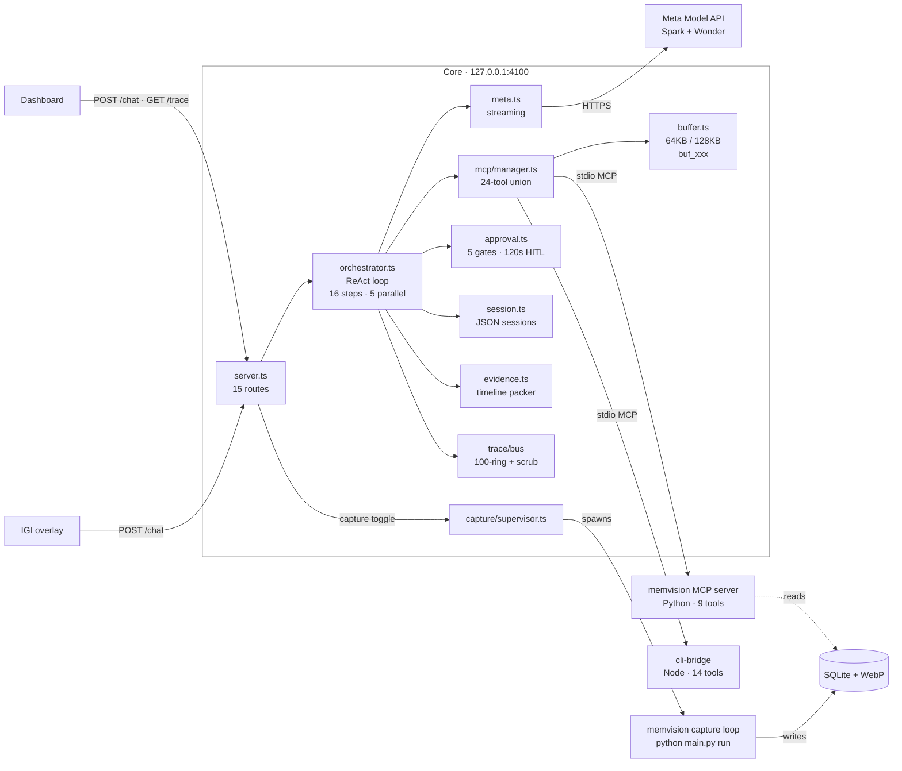

# Core — Server, Agent Loop, MCP Hub (`app/core/` + `app/dashboard/`)

> **TL;DR:** One Node process on `127.0.0.1:4100` that serves the dashboard,
> runs a 16-step / 5-parallel ReAct loop (Spark tools → Wonder synthesis),
> unions 24 MCP tools from two subprocesses, streams a secret-scrubbed trace,
> and gates 5 dangerous tools behind 120s human approval.
> Verified against the submission source; see §14 for known limits.

> Stack: Node 18+, TypeScript 5.7 strict, `node:http` (no Express), MCP SDK 1.0.
> Entry: `npm start` → `node dist/index.js` → `src/index.ts`.

## 1. What it does

Core is the hub everything talks through. It serves the dashboard UI, runs the
ReAct agent loop against the Meta Model API, multiplexes two MCP subprocesses
into one tool surface, streams every step to an observable trace, and gates
dangerous tools behind human approval. One process, port `127.0.0.1:4100`.

## 2. The ReAct loop (`src/agent/orchestrator.ts`)

`runTurn()` loops up to `maxSteps` (default 16). Each `executeStep()`:

1. Picks the model: Spark (`toolModel`) for tool steps, Wonder
   (`synthesisModel`) for the final pass with `tools = []`.
2. Streams one model turn via `provider.callStreaming()` — reasoning tokens go
   to the Thinking drawer, tool calls are reassembled from SSE deltas.
3. Slices the first `maxParallelToolCalls` (default 5); extras get
   `[Skipped: Exceeded maximum parallel tool call limit...]`.
4. Executes the slice with `Promise.allSettled` — one failure becomes
   `[Tool Error: ...]`, the rest continue.
5. Appends every result as a contiguous `role: tool` block, then at most ONE
   multimodal `role: user` image message if a tool returned a screenshot.
   (Strict ordering avoids the tool-sequence HTTP 400.)
6. Repeats until Spark answers directly, or a guard fires.

Synthesis: when two-model routing is on and tools ran (or no terminal answer
exists), Wonder receives `[ACTION RESULTS]` (non-memory, 400 chars each) +
`[VERIFIED TIMELINE EVIDENCE]` (packed JSON, see §7) with tools disabled, and
streams the final answer. Hallucinated tool calls in this phase are discarded.

## 3. Guards that keep it safe

| Guard | Limit | Behavior | Signal |
|---|---|---|---|
| Step cap | 16 steps | Break to synthesis | `step_cap_reached` |
| Parallel cap | 5 calls/step | Extras skipped with notice | in tool results |
| Repeat cap | 2 identical calls/turn | Reuse cached result, break | `isRepeatCapHit` |
| Operator cap | 3 consecutive `execute_command` | Break to synthesis | `operator_limit_reached` |
| Synthesis strip | — | Wonder's tool calls discarded | silent |
| Model fallback | — | Wonder error → retry with Spark | `synthesis_fallback` |

Repeat detection keys on `name + JSON.stringify(args)` per turn. The operator
cap counts consecutive shell calls and resets on any non-shell step.

## 4. MCP hub (`src/mcp/manager.ts`, `src/mcp/buffer.ts`)

Two stdio subprocesses are spawned at boot and unioned into one tool list:

- **memvision:** `memvison/.venv/Scripts/python.exe main.py mcp` → 9 tools
- **cli-bridge:** `node build/index.js --policy policy.json` (cwd
  `../cli-bridge`) → 14 tools
- **internal:** `get_full_result(result_id)` → 1 tool, handled in-process

Total: **24 tools**, translated to Chat Completions
`tools: [{type: "function", function: {name, description, parameters}}]`.

`ToolResultBuffer` truncates anything over 64,000 chars (128,000 for
`read_file`) into an LRU-50 store keyed `buf_<8hex>`, with a preview +
`call get_full_result(...)` pointer. Image blocks from memvision crops are
extracted, passed to the model as `image_url`, and surfaced to the dashboard
as zero-token gallery thumbnails.

## 5. Meta provider (`src/providers/meta.ts`)

`POST {baseUrl}/chat/completions`, `stream: true`, `temperature: 0.2`,
`reasoning_effort` passthrough, `Authorization: Bearer <key>`.
`sanitizeMessagesForMetaApi()` enforces two Meta constraints before every call:

- Only the first message may keep `role: system`; later ones demote to `user`.
- Only the 3 most recent `image_url` parts are kept; older images become the
  text `[Historical Screenshot Analyzed]`.

Reasoning deltas (`reasoning_content` / `reasoning` / `thought`) stream to the
Thinking drawer; usage tokens are captured from the SSE tail.

## 6. Trace bus (`src/trace/bus.ts`)

Every model call, tool call/group, approval, capture event, and error emits a
`TraceEvent` (`tr_<ts>_<rand>`) into a 100-event ring buffer, SSE-streamed via
`GET /trace` (30-event replay on connect, 15s keepalive). All payloads pass
through 7 secret-scrub regexes (`sk-`, `sk-ant-`, `ghp_`, `Bearer`, `AIza`,
key/secret/token assignments) before storage — known credential patterns are
scrubbed from traces and the dashboard.

## 7. Evidence packer (`src/agent/evidence.ts`)

Memory tool results are unusable raw (dozens of overlapping captures), so
`EvidencePacker.packEvidence()` compresses them into a timeline for Wonder:

1. Parse `results[]` / `captures[]` + nested `windows[]`, sort chronologically.
2. Merge same app+title within a 30s gap into segments (max visible fraction,
   OR'd foreground, dedup'd OCR capped at 200 chars).
3. Tag each segment's purpose: `project_tools` / `video` / `coding` /
   `communication` / `research` / `system` / `browsing` (app + title + domain
   heuristics).
4. If > 8 segments, drop sub-3s ones unless the query names that app/title.
5. Emit `{summary: {start, end, total_duration_s, segment_count,
   primary_purposes}, segments[]}` as `[VERIFIED TIMELINE EVIDENCE]`.

## 8. Approvals — two layers (`src/agent/approval.ts` + cli-bridge policy)

Safety is two independent gates that stack. Core asks you; cli-bridge decides
whether the call is allowed at all. Approval in Core never overrides a
cli-bridge restriction.

**Layer 1 — Core HITL (interactive, always-ask).** Five tools pause the loop
on *every* call, with no allow-list bypass at this layer:

| Tool | Prompt |
|---|---|
| `copy_file` | File Copy Authorization (source → dest) |
| `request_path_access` | Filesystem Path Access (path + ro/rw) |
| `execute_command` | Shell Command Execution (command + args) |
| `toggle_dev_mode` (enable) | Developer Mode Activation |
| `request_command_access` | Command Policy Approval |

Each creates an `appr_xxx` request with a 120s auto-deny timer, streamed as
`approval_required` and resolved via `POST /api/approvals/:id`. Denial (or
timeout) returns `[Permission Denied by User...]` and the tool never reaches
cli-bridge. An approved `execute_command` auto-enables Dev Mode on cli-bridge
so the call can proceed. (Identical repeats within one turn are served from
the loop-guard cache before this check, so they don't prompt twice.)

**Layer 2 — cli-bridge policy (non-interactive, fail-closed).** After Layer 1
passes, `checkCommand()` / `checkPath()` re-check inside cli-bridge:
built-in + config restricted commands, inline interpreters
(`powershell -Command`, `cmd /c`), shell metachars, and restricted/outside-root
paths are denied even if you just approved. Its `ask` tier uses a
default-deny approver (no UI on that side), so unknown items only pass via
pre-granted session roots/commands — and restricted entries can never be
granted. Ungated reads/writes inside an allowed `rw` root
(`read_file`, `list_directory`, `grep_content`, `write_file`, `edit_file`)
run without a Layer 1 prompt.

## 9. Sessions (`src/agent/session.ts`)

`sess_<12hex>` IDs persisted to `data/sessions.json` (auto-created). Titles
auto-derive from the first user message (40 chars). The system prompt
(`prompts/system_prompt.txt`, ~11KB, 13 rules + few-shots) is re-rendered with
live UTC + Asia/Kolkata timestamps at the top of every turn via
`prompts/loader.ts`.

## 10. HTTP surface (`src/server.ts`)

Plain `node:http`, 15 method+path routes, 2MB JSON body cap, CORS `*`,
traversal-guarded static serving of `app/dashboard/` with SPA fallback. Auth
is open localhost dev mode (`auth.ts` returns true) — see §14.

| Method + Path | Purpose |
|---|---|
| `GET /health` | Status + model config (`hasApiKey` boolean only) + MCP + capture |
| `GET /tools` | Unioned 24-tool list |
| `GET /trace` | SSE trace stream |
| `POST /chat` | SSE agentic turn (`sessionId?`, `message`, `images?`, `options?`) |
| `GET /api/capture/status` | Capture loop state |
| `POST /api/capture/toggle` | Start/stop capture loop |
| `GET /api/capture/image/:id` | Screenshot data-URL for lightbox (zero model tokens) |
| `GET /api/sessions` | List sessions (no message bodies) |
| `POST /api/sessions` | Create session |
| `GET /api/sessions/:id` | Full session incl. messages |
| `DELETE /api/sessions/:id` | Delete session |
| `GET /api/config` | Settings (`hasApiKey` boolean only, never the key) |
| `POST /api/config` | Save settings (key persisted to `.env` + config) |
| `GET /api/approvals` | List pending HITL requests |
| `POST /api/approvals/:id` | Resolve HITL request (allow/deny) |

## 11. Capture supervisor (`src/capture/supervisor.ts`)

Spawns `python main.py run --interval 2.0` in the memvision dir with resolved
DB/screenshot paths (`windowsHide: true`), pipes informative stdout
(`Captured`/`Dropped`/`Sanitized`) into the trace bus, and kills via
SIGTERM → 1.5s → SIGKILL. Started/stopped only through the dashboard toggle —
never auto-started on boot.

## 12. Dashboard (`app/dashboard/`, zero-build)

Vanilla JS/CSS, no framework, no build step (`index.html` 12KB, `app.js`
66KB, `styles.css` 41KB). SSE chat + trace streams, Thinking drawer with live
timer, collapsible tool cards (name, duration, preview, buffer ID, errors),
screenshot galleries with lightbox, approval Allow/Deny cards, multi-session
sidebar, and a settings modal (provider, model, reasoning, key) persisted via
`POST /api/config`. Rendered markdown is sanitized with DOMPurify.

## 13. File map

| File | Role |
|---|---|
| `src/index.ts` | Boot: config → buffer limit → key check → MCP init → listen |
| `src/config.ts` | Defaults (16/5/64K, Spark/Wonder), JSON + env merge, key resolution |
| `src/server.ts` | 15 routes + static dashboard |
| `src/agent/orchestrator.ts` | ReAct loop, 5 guards, two-model synthesis |
| `src/agent/evidence.ts` | Memory → packed timeline JSON |
| `src/agent/approval.ts` | 5-gate HITL, 120s auto-deny |
| `src/agent/session.ts` | JSON sessions, auto-title |
| `src/mcp/manager.ts` | 2× stdio clients, tool union, image extraction |
| `src/mcp/buffer.ts` | 64K/128K truncation, `buf_xxx` LRU-50 |
| `src/providers/meta.ts` | Meta SSE streaming, 3-image sanitize |
| `src/prompts/loader.ts` | Live-timestamp system prompt render |
| `src/trace/bus.ts` | 100-ring trace + 7-pattern secret scrub |
| `src/capture/supervisor.ts` | Capture subprocess lifecycle |
| `prompts/system_prompt.txt` | 13-rule agent prompt + few-shots |
| `test/` | 6 suites (`node --test`), incl. orchestrator loop guards |
| `eval/quality_eval.js` | 10-question quality harness |

## 14. Known limits

1. **No auth + CORS `*`.** Core accepts any localhost request and answers
   cross-origin. A malicious website open in your browser could read
   `GET /api/approvals` and `POST /api/approvals/:id` to approve a pending
   shell command, or `POST /api/config`. Mitigation planned: reject requests
   whose `Origin` is present and not `http://127.0.0.1:4100` /
   `http://localhost:4100`. Until then, don't run Core while visiting
   untrusted sites.
2. **Hardcoded prompt timezone.** `prompts/loader.ts` defaults to
   `Asia/Kolkata`; relative-day queries ("yesterday") resolve on IST
   boundaries for judges elsewhere. Planned: default to the machine zone via
   `Intl.DateTimeFormat().resolvedOptions().timeZone`.
3. **Trace scrub is pattern-based.** The 7 regexes catch known credential
   shapes; unusual formats can slip through. Treat traces as sensitive.

